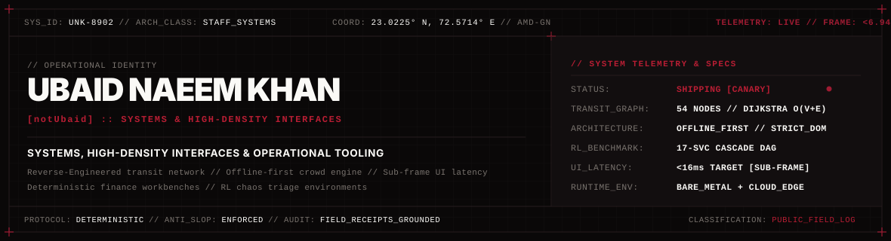
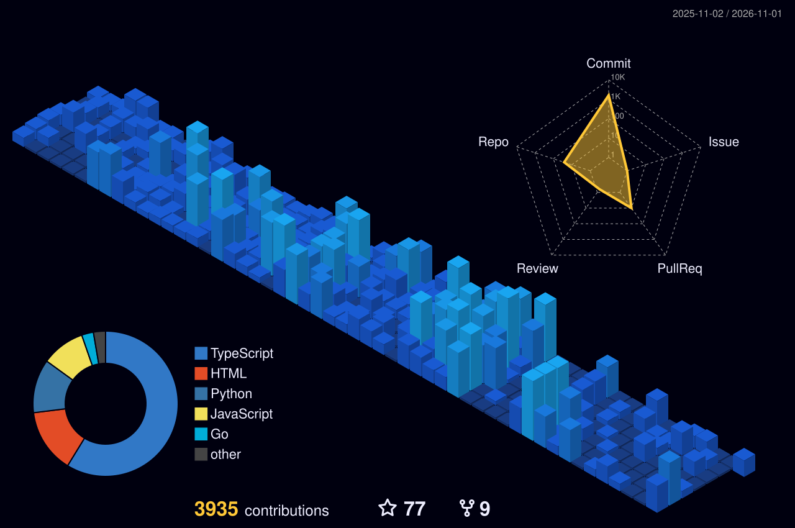

  <picture>
    <source media="(prefers-color-scheme: dark)" srcset="./hero-dark.svg">
    <source media="(prefers-color-scheme: light)" srcset="./hero-light.svg">
    
  </picture>

  

## `// OPERATIONAL FIELD LOG : SELECTED SYSTEMS`

<table width="100%" align="center">
<tr>
<td width="50%" valign="top">

### [FlowGuard // Ahmedabad Metro](https://github.com/notUbaid/ahmedabadmetro)
`OFFLINE-FIRST TRANSIT CONTROLLER &amp; TELEMETRY`

Reverse-engineered official Gujarat Metro public schedule releases into a structured 32K-line canonical graph when no public API existed. Implemented Dijkstra pathfinding across 54 stations with deterministic transfer scheduling. Built and field-tested offline-first PWA architecture aboard moving train cars under total cellular outage.

`TypeScript` `React 19` `PWA / ServiceWorker` `Dijkstra O(V+E)` `Vite`

</td>
<td width="50%" valign="top">

### [Cloud Alert Triage](https://github.com/notUbaid/cloud-alert-triage)
`AUTONOMOUS SRE CHAOS BENCHMARK (OPENENV)`

Reinforcement learning benchmark testing autonomous incident-response agents on a 17-service microservice DAG. Models real-world alert fatigue with dynamic cascading outages (untriaged root failures spawn live dependent alarms), stealth data-layer degradation, and noise discrimination. *Built for Meta × PyTorch × Hugging Face OpenEnv Hackathon 2026.*

`Python 3.11` `FastAPI` `Docker` `Gymnasium` `OpenEnv` `Pydantic v2`

</td>
</tr>
<tr>
<td width="50%" valign="top">

### High-Density Fintech Workspace
`SUB-FRAME EXECUTION &amp; STRICT NUMERIC WORKBENCH`

Deterministic financial data workbench engineered for strict sub-frame latency (&lt;16ms target). Eliminates DOM bloat through virtualized grid layers, arbitrary-precision decimal arithmetic to prevent floating-point drift, and keyboard-first shortcut mechanics for zero-latency execution.

`TypeScript` `Strict Decimals` `Virtualized DOM` `Keyboard Navigation`

</td>
<td width="50%" valign="top">

### Campus Sync (Campus Sense)
`MULTI-STUDENT CONSTRAINT &amp; TIMETABLE SOLVER`

Mobile-optimized scheduling engine designed for institutional committee coordination. Solves multi-dimensional timetable conflict matrices across student course rosters, faculty availability, and room capacity constraints with instant client-side resolution.

`Next.js` `TypeScript` `Constraint Engine` `Tailwind CSS`

</td>
</tr>
<tr>
<td width="50%" valign="top">

### [Veda Hospital Suite](https://veda-management.vercel.app/) &amp; Talent Lens
`CRITICAL LOGISTICS &amp; BOUNDED AST EXTRACTION`

Dual systems engineering: Veda automates hospital pharmacy supply chains with First-Expired, First-Out (FEFO) batch tracking and predictive stock depletion models (*2nd place, Aetrix Hackathon @ PDEU 2026*). Talent Lens runs high-throughput, schema-bounded AST extraction for automated resume telemetry.

`React 19` `TypeScript` `Firebase` `Gemini 1.5` `AST Extraction`

</td>
<td width="50%" valign="top">

### Infrastructure &amp; Technical Governance
`SYSTEMS LEADERSHIP &amp; CLOUD DEPLOYMENTS`

Digital Head at Technical Club (Institute of Advanced Research, Gandhinagar) — overseeing club deployment pipelines, event infrastructure, and internal developer platforms. Microsoft Student Ambassador leading technical sessions on cloud architectures and deterministic web engineering.

`DevOps` `CI/CD Pipelines` `Technical Governance` `Cloud Architecture`

</td>
</tr>
</table>

 

  <picture>
    <source media="(prefers-color-scheme: dark)" srcset="./dist/github-contribution-grid-snake-dark.svg">
    <source media="(prefers-color-scheme: light)" srcset="./dist/github-contribution-grid-snake.svg">
    
  </picture>

 

  
<code>// EXPAND_SYSTEM_TELEMETRY (3D_CONTRIB &amp; METRICS)</code>

   
  

    
    
  

 

---

  <code>[ <a href="./resume.pdf">OPERATIONAL_RESUME.pdf</a> ]</code> &nbsp;·&nbsp;
  <code>[ <a href="https://github.com/notUbaid">GITHUB://notUbaid</a> ]</code> &nbsp;·&nbsp;
  <code>[ <a href="https://linkedin.com/in/notubaid">LINKEDIN://in/notubaid</a> ]</code> &nbsp;·&nbsp;
  <code>[ <a href="https://linktr.ee/csgc">DISPATCH://csgc</a> ]</code>

